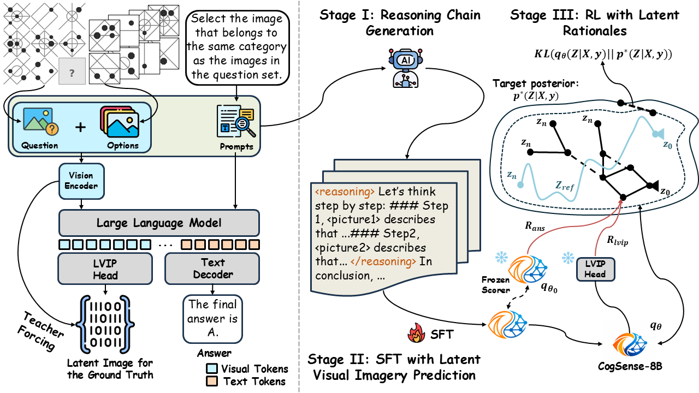
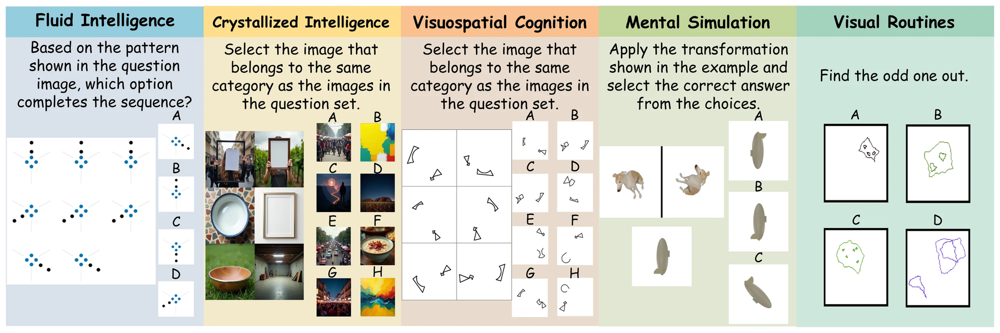

<h1 align="center">Toward Cognitive Supersensing in Multimodal Large Language Models</h1>

<p align="center">
  <a href="https://resurgamm.github.io/">Boyi Li</a><sup>1*</sup>,
  <a href="https://shenyifans.github.io/">Yifan Shen</a><sup>1*§</sup>,
  <a href="https://www.linkedin.com/in/yuanzhe-liu-upenn-ds/">Yuanzhe Liu</a><sup>1*</sup>,
  <a href="https://yfxu.org/">Yifan Xu</a><sup>1</sup>,
  <a href="https://lumos-jiateng.github.io/">Jiateng Liu</a><sup>1</sup>,
  <a href="https://xinzhuo20.github.io/">Xinzhuo Li</a><sup>1</sup>,
  <a href="https://scholar.google.com/citations?user=HXN7DNoAAAAJ&hl=en">Zhengyuan Li</a><sup>1</sup>,
  <a href="https://www.linkedin.com/in/jingyuan-zhu-6a0ab3322/">Jingyuan Zhu</a><sup>2</sup>,
  Yunhan Zhong<sup>1</sup>,
  Fangzhou Lan<sup>2</sup>,
  <a href="https://scholar.google.com/citations?user=dPPOpHUAAAAJ&hl=en">Jianguo Cao</a><sup>2</sup>,
  <a href="https://rehg.org/">James M. Rehg</a><sup>1</sup>,
  <a href="https://blender.cs.illinois.edu/hengji.html">Heng Ji</a><sup>1</sup>,
  <a href="https://isminoula.github.io/">Ismini Lourentzou</a><sup>1†</sup>,
  <a href="https://www.irohxucao.com/">Xu Cao</a><sup>1,2†</sup>
  <br>
  <sup>1</sup>University of Illinois Urbana-Champaign &nbsp;&nbsp; <sup>2</sup>PediaMed AI
  <br>
  <sup>*</sup>Equal contribution &nbsp;&nbsp; <sup>§</sup>Project lead &nbsp;&nbsp; <sup>†</sup>Corresponding author
</p>

<p align="center">
  
  <a href="https://arxiv.org/abs/2602.01541"></a>
  <a href="https://pediamedai.com/Cognition-MLLM/cogsense/"></a>
  <a href="https://huggingface.co/PediaMedAI/CogSense-8B"></a>
  <a href="https://huggingface.co/datasets/PediaMedAI/CogSense-Bench"></a>
</p>

<p align="center">
  
</p>

## Abstract

Multimodal Large Language Models (MLLMs) have achieved remarkable success in open-vocabulary perceptual tasks, yet their ability to solve complex cognitive problems remains limited, especially when visual details are abstract and require visual memory. Current approaches primarily scale Chain-of-Thought (CoT) reasoning in the text space, even when language alone is insufficient for clear and structured reasoning, and largely neglect visual reasoning mechanisms analogous to the human visuospatial sketchpad and visual imagery. To mitigate this deficiency, we introduce Cognitive Supersensing, a novel training paradigm that endows MLLMs with human-like visual imagery capabilities by integrating a Latent Visual Imagery Prediction (LVIP) head that jointly learns sequences of visual cognitive latent embeddings and aligns them with the answer, thereby forming vision-based internal reasoning chains. We further introduce a reinforcement learning stage that optimizes text reasoning paths based on this grounded visual latent. To evaluate the cognitive capabilities of MLLMs, we present CogSense-Bench, a comprehensive visual question answering (VQA) benchmark assessing five cognitive dimensions. Extensive experiments demonstrate that MLLMs trained with Cognitive Supersensing significantly outperform state-of-the-art baselines on CogSense-Bench and exhibit superior generalization on out-of-domain mathematics and science VQA benchmarks, suggesting that internal visual imagery is potentially key to bridging the gap between perceptual recognition and cognitive understanding.

## CogSense-Bench

<p align="center">
  
</p>

## Installation

```bash
pip install -r requirements.txt
pip install flash-attn --no-build-isolation   # or run the training scripts with ATTN_IMPL=sdpa
```

## Training

### SFT with LVIP

```bash
bash qwen-vl-finetune/scripts/sft_cogsense.sh
```

8 GPUs, DeepSpeed ZeRO-3, from `Qwen/Qwen3-VL-8B-Instruct`. Output: `qwen-vl-finetune/output/cogsense-8b-sft-lvip`.

### RL with latent rationales

```bash
SFT_MODEL=./output/cogsense-8b-sft-lvip bash qwen-vl-finetune/scripts/rl_cogsense.sh
```

`SFT_MODEL` is the SFT checkpoint (path relative to `qwen-vl-finetune/`). 8 GPUs, DeepSpeed ZeRO-3. The LoRA adapter is saved to `qwen-vl-finetune/output/cogsense-8b-rl-lora` and merged into `qwen-vl-finetune/output/cogsense-8b-rl`. To merge by hand:

```bash
python qwen-vl-finetune/tools/merge_lora.py --base <SFT checkpoint> --adapter <adapter dir> --output <merged dir>
```

| Option | Value | Meaning |
|---|---|---|
| `--explore_nums` / `--explore_min_bs` | `6` / `2` | Rationales sampled per question, in groups of 2 |
| `--rat_max_len` / `--rat_min_len` | `1024` / `16` | Rationale length limits (tokens) |
| `--pf_temp_low` / `--pf_temp_high` | `0.5` / `1.0` | Sampling temperature range |
| `--reward_alpha` / `--reward_gamma` | `1.0` / `1.0` | Weights of the answer reward and the LVIP reward |
| `--reward_anchor_stride` | `8` | Stride of the reward anchors |
| `--delta_start` / `--delta_end` / `--delta_horizon` | `0.1` / `1.0` / `50` | Keep a sample if its reward ≥ the reference rationale's reward + log δ; δ goes from 0.1 to 1.0 over 50 steps |
| `--lora_r` / `--lora_alpha` | `64` / `128` | LoRA rank and alpha |

## Inference

### Evaluation on CogSense-Bench

```bash
bash evaluation/run_eval_lvip.sh
```

Variables at the top of the script:

- `MODEL_PATH`: `PediaMedAI/CogSense-8B` or your checkpoint
- `BENCH_PATH`: path to `CogSense-Bench.jsonl`
- `GPU_ID`
- `USE_LLM_EXTRACTION`: extract the answer letter with GPT-4o-mini (needs `OPENAI_API_KEY`; otherwise rule-based)
- `TEST_MODE`: `"true"` evaluates only 5 samples

Results (`result_lvip_<time>.json`, `report_lvip_<time>.md`) are written to `OUTPUT_DIR`.

### Python

```python
import sys
import torch
from transformers import AutoProcessor

sys.path.insert(0, "qwen-vl-finetune")
from qwenvl.models.modeling_cogsense import CogSenseForConditionalGeneration

model = CogSenseForConditionalGeneration.from_pretrained(
    "PediaMedAI/CogSense-8B", dtype=torch.bfloat16, device_map="cuda"
)
processor = AutoProcessor.from_pretrained("PediaMedAI/CogSense-8B")
```

Build the messages with `make_chat_input` and run them with `call_model` from `evaluation/eval_lvip.py`.

## Citation

```bibtex
@inproceedings{li2026cognitive,
  title     = {Toward Cognitive Supersensing in Multimodal Large Language Models},
  author    = {Li, Boyi and Shen, Yifan and Liu, Yuanzhe and Xu, Yifan and
               Liu, Jiateng and Li, Xinzhuo and Li, Zhengyuan and Zhu, Jingyuan and
               Zhong, Yunhan and Lan, Fangzhou and Cao, Jianguo and Rehg, James M. and
               Ji, Heng and Lourentzou, Ismini and Cao, Xu},
  booktitle = {Advances in Neural Information Processing Systems (NeurIPS)},
  year      = {2026}
}
```
